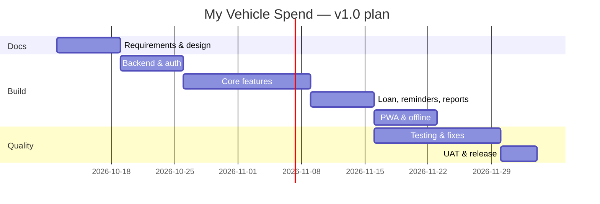

# Software Project Management Plan (SPMP) — My Vehicle Spend

| Field        | Value                               |
| ------------ | ----------------------------------- |
| Version      | 1.0 (Draft)                         |
| Date         | 2026-10-11                          |
| Project type | Solo / personal open-source project |

## 1. Project Overview

Build and release My Vehicle Spend v1.0 — a free PWA for Indian vehicle expense and loan tracking — in about 7 weeks of part-time effort (≈ 10–12 h/week).

## 2. Deliverables

| #   | Deliverable                                         | Format              | Due    |
| --- | --------------------------------------------------- | ------------------- | ------ |
| D1  | Requirements & planning docs (this set, section 1)  | Markdown            | Week 1 |
| D2  | Design & architecture docs (section 2)              | Markdown + Mermaid  | Week 1 |
| D3  | Working backend (schema, RLS, auth, storage)        | SQL migrations      | Week 2 |
| D4  | Core app (vehicles, expenses, fuel)                 | Source code         | Week 4 |
| D5  | Loan tracker, reminders, reports                    | Source code         | Week 5 |
| D6  | PWA features, offline queue                         | Source code         | Week 6 |
| D7  | Test cases, executed test log, UAT report           | Markdown            | Week 7 |
| D8  | Deployed v1.0 + release notes + user & admin guides | Markdown + live URL | Week 7 |

## 3. Timeline

| Phase                    | Start      | End        | Milestone                |
| ------------------------ | ---------- | ---------- | ------------------------ |
| Docs                     | 2026-10-12 | 2026-10-18 | M0 Docs approved         |
| Backend & auth           | 2026-10-19 | 2026-10-25 | M1 Schema + auth         |
| Core features            | 2026-10-26 | 2026-11-08 | M2 Expenses & fuel       |
| Loan, reminders, reports | 2026-11-09 | 2026-11-15 | M3 Loan & reports        |
| PWA & offline            | 2026-11-16 | 2026-11-22 | M4 Installable + offline |
| Testing                  | 2026-11-02 | 2026-11-22 | Continuous               |
| UAT & release            | 2026-11-23 | 2026-11-26 | M5 v1.0 release          |

Dates are targets; adjust in the tracker as work proceeds.

## 4. Roles & Responsibilities

| Role          | Person                               | Responsibilities                     |
| ------------- | ------------------------------------ | ------------------------------------ |
| Product owner | Owner                                | Scope decisions, UAT sign-off        |
| Developer     | Owner / contributor                  | Design, code, unit tests, deployment |
| Tester        | Owner (independent pass recommended) | System tests, defect logging         |
| Documentation | Owner                                | Keep docs in sync with code          |

## 5. Work Breakdown Structure (summary)

1. Project setup (repo, tooling, CI)
2. Backend: schema, RLS, storage, auth
3. Frontend shell: routing, layout, theme, i18n strings
4. Vehicles module
5. Expenses module (+ receipts)
6. Fuel module (+ mileage)
7. Reminders module
8. Loan module (EMI engine, schedule, simulations)
9. Dashboard & reports, CSV/JSON export
10. PWA: manifest, service worker, offline queue
11. Security hardening & account deletion
12. Testing, UAT, documentation, release

## 6. Tools & Environment (all free / open source)

| Purpose           | Tool                                | Free tier / licence                                     |
| ----------------- | ----------------------------------- | ------------------------------------------------------- |
| Code hosting      | GitHub                              | Free public & private repos                             |
| Source control    | Git                                 | GPL-2.0                                                 |
| Editor            | VS Code                             | MIT (free)                                              |
| Runtime           | Node.js LTS                         | MIT                                                     |
| Package manager   | npm (or pnpm)                       | Open source                                             |
| Frontend          | React, Vite, TypeScript             | MIT / Apache-2.0                                        |
| PWA               | vite-plugin-pwa, Workbox            | MIT                                                     |
| Charts            | Recharts                            | MIT                                                     |
| Validation        | Zod                                 | MIT                                                     |
| Offline storage   | Dexie.js                            | Apache-2.0                                              |
| Backend           | Supabase                            | Open source core; free tier                             |
| Local Supabase    | Supabase CLI + Docker               | Apache-2.0                                              |
| Hosting           | Cloudflare Pages / Netlify / Vercel | Free tiers                                              |
| CI                | GitHub Actions                      | Free minutes for public repos (2,000 min/month private) |
| Tests             | Vitest, Testing Library, Playwright | MIT / Apache-2.0                                        |
| Lighthouse audits | Chrome Lighthouse                   | Apache-2.0                                              |
| Docs diagrams     | Mermaid                             | MIT                                                     |
| Uptime monitor    | UptimeRobot / GitHub Actions cron   | Free tier                                               |

Verify each free-tier quota before go-live.

## 7. Communication & Reporting

- Weekly self-review every Sunday: progress vs. plan, blockers, scope changes.
- Decisions recorded in `docs/decision-log.md` (create when implementation starts).
- Changes to requirements go through a change request (section 9).

## 8. Risk Management

| ID  | Risk                                           | Probability | Impact   | Score  | Mitigation                                                                 | Owner |
| --- | ---------------------------------------------- | ----------- | -------- | ------ | -------------------------------------------------------------------------- | ----- |
| R1  | Supabase free project paused after 7 days idle | High        | Medium   | High   | Keep-alive GitHub Action every 3 days; document restore                    | Dev   |
| R2  | Scope creep (bank import, multi-user)          | High        | High     | High   | Strict v1.0 scope; park in v2 backlog                                      | PO    |
| R3  | Offline sync conflicts                         | Medium      | High     | High   | Client UUIDs, insert-only queue, last-write-wins for edits with timestamps | Dev   |
| R4  | RLS misconfiguration exposes data              | Low         | Critical | High   | RLS tests in STC; automated policy test script                             | Dev   |
| R5  | EMI calculation error                          | Medium      | High     | High   | Unit tests against bank-published sample schedules                         | Dev   |
| R6  | Free email quota blocks sign-up                | Medium      | Medium   | Medium | Use invite-only or custom SMTP later                                       | Dev   |
| R7  | Data loss on phone change                      | Medium      | High     | High   | JSON backup feature + reminder to export monthly                           | Dev   |
| R8  | Developer time shortfall                       | Medium      | Medium   | Medium | Buffer week; drop Should items first                                       | PO    |
| R9  | Browser PWA limits on iOS (no background sync) | High        | Low      | Medium | Sync on app open; manual sync button                                       | Dev   |

Score = Probability × Impact (Low=1, Medium=2, High=3). Review risks at each milestone.

## 9. Change Management

1. Raise change request (what, why, impact on scope/time).
2. Assess impact on SRS, tests, and schedule.
3. Product owner approves or defers to v2 backlog.
4. Update affected documents and version numbers.

## 10. Quality Plan Summary

See Test Strategy (04-testing/01). Quality gates: all Must tests passed; zero open Critical/High defects; Lighthouse PWA check passed.

## 11. Configuration Management

- Git with `main` (protected, release-ready) and `develop` branches; feature branches `feat/*`, fixes `fix/*`.
- Semantic versioning: `MAJOR.MINOR.PATCH`, starting at `0.1.0` for first build, `1.0.0` at UAT sign-off.
- Git tags for each release.

## 12. Budget

| Item                    | Cost                                                          |
| ----------------------- | ------------------------------------------------------------- |
| Software licences       | ₹0                                                            |
| Supabase / hosting / CI | ₹0 (free tiers)                                               |
| Domain (optional)       | ~₹800–1,000/year, optional — use free `*.pages.dev` subdomain |
| **Total**               | **₹0 mandatory**                                              |
