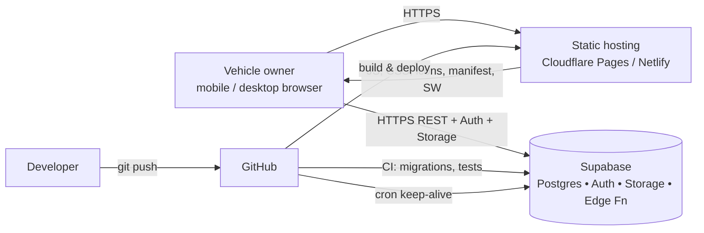
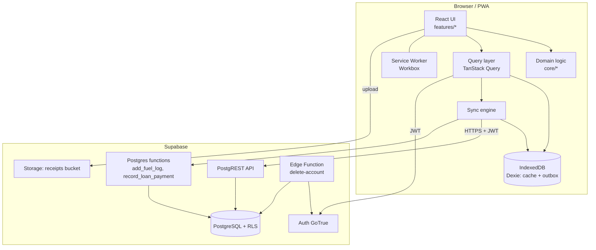
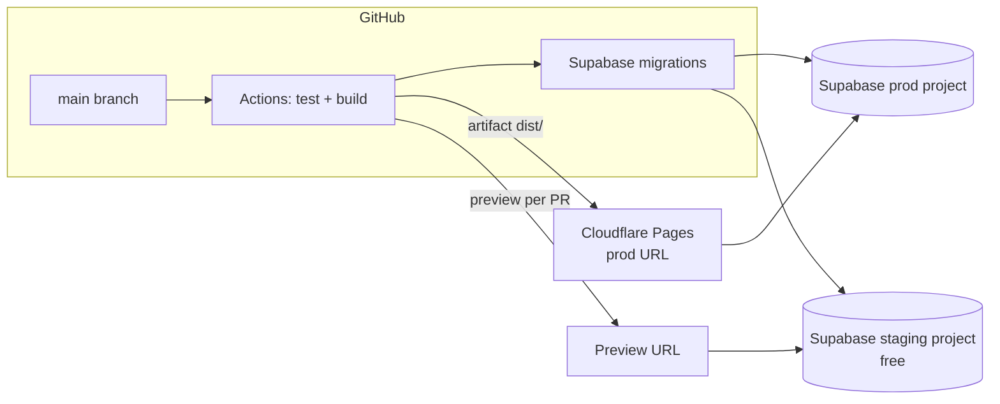

# System Architecture Document — My Vehicle Spend

| Field   | Value       |
| ------- | ----------- |
| Version | 1.0 (Draft) |
| Date    | 2026-10-11  |

## 1. Architecture Summary

A **Jamstack-style PWA**: static React bundle on a free CDN, talking directly to **Supabase** (managed Postgres, Auth, Storage, Edge Functions). Users' browsers are the main compute. This gives zero servers to maintain and zero cost at personal scale.

## 2. Context Diagram

## 3. Component Architecture

## 4. Layers

| Layer                | Technology                                          | Notes                                           |
| -------------------- | --------------------------------------------------- | ----------------------------------------------- |
| Presentation         | React 18, React Router, CSS Modules or Tailwind CSS | Mobile-first                                    |
| Domain               | Pure TypeScript (`src/core`)                        | Testable without DOM                            |
| Client data          | TanStack Query + Dexie                              | Cache and offline outbox                        |
| PWA                  | vite-plugin-pwa (Workbox)                           | Precaching app shell, runtime cache for API GET |
| API                  | Supabase PostgREST (auto REST from schema)          | Filters via query string                        |
| Business rules in DB | CHECK constraints, triggers, RPC functions          | Data integrity independent of client            |
| Auth                 | Supabase Auth (JWT, email)                          | Refresh tokens rotated                          |
| Storage              | Supabase Storage (private bucket)                   | Signed URLs                                     |
| Functions            | Supabase Edge Functions (Deno)                      | Only for account deletion                       |
| Hosting              | Cloudflare Pages (primary) / Netlify (alt)          | Free, HTTPS, global CDN                         |
| CI/CD                | GitHub Actions                                      | Lint, test, build, migrate, deploy              |

## 5. Data Flow Scenarios

### 5.1 Add fuel fill (online)

1. UI submits form → `core/validation` checks.
2. `data/fuel.add()` calls RPC `add_fuel_log(p_id, p_vehicle_id, p_date, p_odometer, p_litres, p_price, p_full, p_station, p_payment_mode)`.
3. Postgres inserts `fuel_logs` row **and** matching `expenses` row in one transaction.
4. Response returns both IDs → Dexie updated → dashboard re-queries.

### 5.2 Add fuel fill (offline)

1. Same validation; `id` generated on client.
2. Dexie writes to `fuel_logs` (local) and `outbox`.
3. UI shows "Saved offline · 1 pending".
4. When `navigator.onLine` or `online` event fires → SyncEngine replays outbox; RPC is idempotent on `p_id` (`ON CONFLICT (id) DO NOTHING`).

### 5.3 Loan EMI payment

1. User taps **Mark EMI paid** on installment #14.
2. RPC `record_loan_payment(...)` updates `loan_payments` row and inserts expense (category EMI, amount = EMI + late fee + bounce, interest stored in `loan_payments`).

### 5.4 Dashboard load

1. Query views `v_monthly_spend` filtered by vehicle and date range.
2. Query `v_fuel_efficiency` for selected vehicle.
3. Query `reminders` where `due_date <= today + 30` and not done.
4. Served from cache if offline; stale-while-revalidate.

### 5.5 Account deletion

1. User confirms by typing "DELETE".
2. Client calls Edge Function `delete-account` with user JWT.
3. Function verifies JWT, deletes storage objects under `{uid}/`, then deletes `auth.users` row (cascades to all user tables).

## 6. Deployment View

Two free Supabase projects are used: **staging** and **production**. Free accounts can have multiple projects (within the org limit).

## 7. Security Architecture

| Boundary           | Control                                                      |
| ------------------ | ------------------------------------------------------------ |
| Browser ↔ Supabase | HTTPS, JWT in `Authorization` header, anon key public        |
| API ↔ Tables       | RLS policies per table, `auth.uid()` checks                  |
| Storage ↔ Files    | Bucket private, storage policy by folder = uid               |
| Secrets            | Service role key only in Edge Function env and never in repo |
| Web app ↔ Browser  | CSP, HSTS (via host), no inline scripts                      |
| Repo ↔ Public      | `.env` in `.gitignore`; secret scanning enabled on GitHub    |

## 8. Scalability & Free-Tier Capacity

| Resource (Supabase free, verify current) | Expected use (1 user)    | Headroom  |
| ---------------------------------------- | ------------------------ | --------- |
| Database size 500 MB                     | < 10 MB per 10k rows     | Very high |
| File storage 1 GB                        | ~1 MB per receipt × 500  | High      |
| Monthly active users 50,000              | < 50                     | Very high |
| Egress ~5 GB/month                       | < 100 MB                 | High      |
| Edge Function invocations (free quota)   | Only on account deletion | Very high |
| Projects pause after 7 idle days         | Handled by keep-alive    | Mitigated |

When any quota is near 80%, see the Sysadmin Guide for upgrade path (Supabase Pro is paid; not required for v1.0).

## 9. Non-Functional Architecture Decisions

| ID   | Decision                            | Reason                                          |
| ---- | ----------------------------------- | ----------------------------------------------- |
| AD-1 | No custom backend server            | Zero cost, fewer components                     |
| AD-2 | Postgres RPC for multi-table writes | Atomicity, offline-safe idempotency             |
| AD-3 | Client UUIDs                        | Offline creation without ID collisions          |
| AD-4 | Soft delete on synced tables        | Sync correctness                                |
| AD-5 | Recharts for charts                 | Free, React-native, lightweight                 |
| AD-6 | Vite over Next.js                   | Pure static output simpler for PWA on free host |

## 10. Future Architecture (v2)

- Family sharing: `vehicle_members` table + RLS using membership check.
- Hindi/Marathi i18n via `react-i18next` (MIT).
- Optional bank SMS parsing via user-triggered import only (no server-side scraping).
