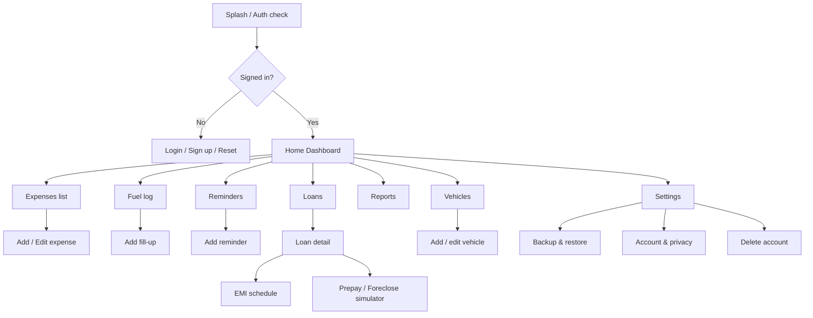
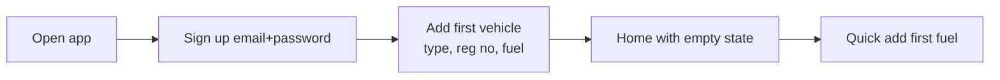
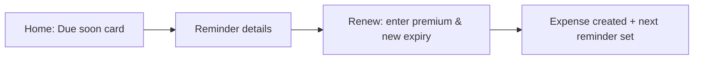
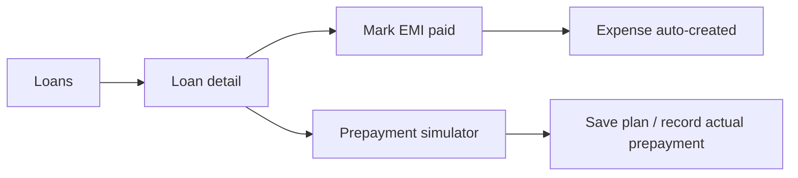

# UI/UX Design Document — My Vehicle Spend

| Field | Value |
|---|---|
| Version | 1.0 (Draft) |
| Date | 2026-10-11 |
| Design approach | Mobile-first, one-hand, Indian-English content |

## 1. Design Principles
1. **Log in ≤ 3 taps.** Primary action (+) is always visible.
2. **Money is always readable.** ₹ symbol, Indian grouping, right-aligned.
3. **Plain Indian English.** "Insurance renewal", "PUC expiry", "FASTag recharge".
4. **Forgiving forms.** Defaults to today, last odometer, last station.
5. **Calm visuals.** Neutral background, one accent colour, warnings in amber/red only when needed.

## 2. Information Architecture (sitemap)



## 3. Bottom Navigation (mobile)
| Tab | Icon | Purpose |
|---|---|---|
| Home | 🏠 | Dashboard, active vehicle, due reminders |
| Expenses | 🧾 | All expenses list, filter |
| **+** | ➕ | Quick add sheet (Expense, Fuel, Reminder, EMI) |
| Loans | 🏦 | Loan list and schedule |
| More | ⋯ | Vehicles, Reports, Settings |

On desktop (≥ 1024 px) the bottom bar becomes a left sidebar.

## 4. Key Screens — Wireframes

### 4.1 Home Dashboard (mobile)
```
+-------------------------------------------+
| My Vehicle Spend        [MH12AB1234 ▼]  ⚙ |
+-------------------------------------------+
| This month                                 |
|   ₹ 14,850.00        ↑ 8% vs last month   |
|   Cost/km ₹ 6.42  ·  Km/l 16.8            |
+-------------------------------------------+
| Spend by category                          |
|   [ donut chart ]   Fuel      62%          |
|                    Service    18%          |
|                    Insurance  12%          |
+-------------------------------------------+
| Due soon                                   |
|  ⚠ PUC expires in 6 days        [Mark done]|
|  ● Insurance renews 02 Dec      [Details]  |
+-------------------------------------------+
| Loan: Car loan · ₹3,42,118 outstanding     |
|  EMI ₹12,480 · next 05/11/2026   [Pay]     |
+-------------------------------------------+
|  🏠    🧾     ➕     🏦     ⋯              |
+-------------------------------------------+
```

### 4.2 Quick Add sheet
```
+-------------------------------------------+
| Add entry                            ✕    |
+-------------------------------------------+
|  [ ⛽ Fuel ]  [ 🧾 Expense ]  [ 🔔 Reminder ] |
|  [ 🏦 EMI paid ]                            |
+-------------------------------------------+
```

### 4.3 Fuel fill-up form
```
Fuel fill-up                        Save
Date      [ 11/10/2026 ]
Odometer  [ 48,210 ] km      (last: 48,002)
Litres    [ 32.50 ]   Price/L [ ₹ 102.40 ]
Total     ₹ 3,328.00  (auto)
[ ● Full tank ]  [ ○ Partial ]
Station   [ HP Pump, Pune ▾ ]
Payment   (UPI) (Cash) (Card)
Receipt   [ + Photo ]
```

### 4.4 Expense add/edit
```
Add expense                          Save
Vehicle   MH12AB1234 (Car)
Date      11/10/2026
Category  Maintenance ▸ Periodic service
Amount    ₹ 4,850.00      GST incl. ₹ 740.00
Vendor    Sharma Motors
Payment   (UPI) (Card) (Cash) (FASTag) (EMI)
Odometer  48,210 km
Notes     Oil + filter + labour
Receipts  [📷 Add]  (up to 3)
```

### 4.5 Loan detail
```
Car loan · HDFC (xx1234)            ⋯
Principal ₹8,00,000  Rate 9.25%  60 mo
EMI ₹16,703.92   Start 01/03/2025
---------------------------------
Outstanding ₹5,82,411     Paid 14 / 60
Interest paid ₹1,02,870   Remaining interest ₹1,88,400
Next EMI 05/11/2026 · ₹16,703.92 (principal 11,020 · interest 5,605)

[ Mark EMI paid ]   [ Simulate prepayment ]
[ EMI schedule ]    [ Foreclosure estimate ]
```

### 4.6 Prepayment simulator
```
Prepayment amount  [ ₹ 1,00,000 ]
Paid on            [ 15/11/2026 ]
Option  (•) Reduce tenure   ( ) Reduce EMI

Result
  Months saved       9
  Interest saved     ₹ 38,210
  New end date       Aug 2030
[ Save as plan ]
```

### 4.7 Reports
```
Period [ This FY (Apr 2026–Mar 2027) ▾ ]   Vehicle [ All ▾ ]
[ Bar chart: monthly spend ]
Category table     Amount     % 
Fuel               92,300    61%
Insurance          18,400    12%
...
[ Export CSV ]   [ Export JSON backup ]
```

### 4.8 Reminder form
```
Reminder type   ( Insurance ) ( PUC ) ( Licence ) ( Service by km ) ( Custom )
Due date        [ 02/12/2026 ]
Remind me       [ 15 ] days before
Insurer         [ ICICI Lombard ]     Policy no. [ ... ]
Premium ₹       IDV ₹ [ ... ]
[ Save ]
```

## 5. User Flows

### 5.1 First-time setup


### 5.2 Renew insurance


### 5.3 EMI payment and prepay


## 6. Visual Design

### 6.1 Colour tokens (WCAG AA contrast on white and dark)
| Token | Light | Dark | Use |
|---|---|---|---|
| `--bg` | #FFFFFF | #0F1115 | Background |
| `--surface` | #F5F7FA | #1A1D24 | Cards |
| `--text` | #1A1F2B | #E8ECF2 | Body text |
| `--muted` | #5B6475 | #9AA3B2 | Secondary text |
| `--primary` | #0B6E4F | #3CC59A | Primary buttons, links |
| `--warn` | #B26A00 | #F5B041 | Due soon |
| `--danger` | #B3261E | #F2B8B5 | Overdue, delete |
| `--info` | #1D4E89 | #8AB4F8 | Info banners |

### 6.2 Category colours (donut)
Fuel #0B6E4F · Service #1D4E89 · Insurance #7A4EAB · Taxes & RTO #B26A00 · Tolls & Parking #2E8B57 · Traffic fines #B3261E · Loan & finance #5B6475 · Accessories #C0508A · Other #9AA3B2.

### 6.3 Typography
System UI stack: `-apple-system, Segoe UI, Roboto, Noto Sans, sans-serif`. Body 16 px, labels 14 px, big numbers 28–32 px with tabular figures (`font-variant-numeric: tabular-nums`).

### 6.4 Spacing & shape
8 px grid. Card radius 12 px. Button height 44 px. Inputs 44 px.

## 7. Formatting Rules
| Data | Display | Example |
|---|---|---|
| Money | ₹ + Indian grouping, 2 decimals | ₹1,23,456.00 |
| Large money | Lakh/Crore words optional | ₹1.23 L |
| Date | DD/MM/YYYY (or "11 Oct 2026") | 11/10/2026 |
| Odometer | Indian grouping, km suffix | 48,210 km |
| Mileage | 1 decimal | 16.8 km/l |
| Cost per km | 2 decimals | ₹6.42/km |
| Registration | Upper-case, spaced for display | MH 12 AB 1234 |

## 8. Accessibility
- Contrast ≥ 4.5:1 for body text.
- All icons paired with text labels on bottom nav.
- Focus rings visible; keyboard navigation for desktop.
- Form errors announced with `aria-live="polite"`.
- Charts have a data table alternative toggle.

## 9. Empty, Loading & Error States
| State | Design |
|---|---|
| No vehicles | Illustration + "Add your car or bike" button |
| No expenses | "Log your first petrol fill" hint |
| Offline | Grey banner "Offline — changes will sync later" |
| Pending sync | Badge on + icon with count |
| Error | Banner with retry button and plain message |

## 10. PWA Install UX
- Custom install prompt shown after 2nd visit, never on first load.
- iOS: instructional sheet "Share → Add to Home Screen".

## 11. Content Style
- Sentence case for labels.
- Verb-first buttons: "Save fuel", "Add expense".
- Avoid jargon; include short hint text (e.g. "Full tank = filled to the top").
