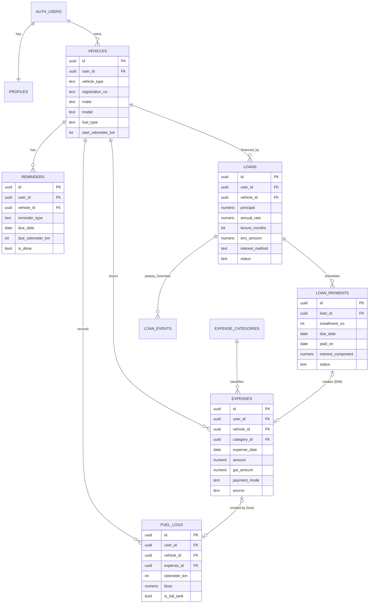

# Database Schema Design — My Vehicle Spend

| Field          | Value                                          |
| -------------- | ---------------------------------------------- |
| Version        | 1.0 (Draft)                                    |
| Date           | 2026-10-11                                     |
| Engine         | PostgreSQL 15 (Supabase)                       |
| Migration tool | Supabase CLI (`supabase migration new <name>`) |

## 1. Conventions

- Table names: `snake_case`, plural.
- Primary keys: `uuid`, client-generated (for offline) with default `gen_random_uuid()`.
- Money: `numeric(12,2)` (INR, rupees and paise). Rates: `numeric(6,3)`.
- Timestamps: `timestamptz`, UTC. Business dates: `date` (interpreted in Asia/Kolkata).
- Every user-owned table has `user_id`, `created_at`, `updated_at`, `deleted_at` (soft delete).
- Child rows carry `vehicle_id` with composite FK `(vehicle_id, user_id)` so a user cannot attach data to another user's vehicle.

## 2. Entity-Relationship Diagram



## 3. Table Definitions (SQL)

> Target file: `supabase/migrations/0001_init.sql` (to be created in implementation phase). The SQL below is the authoritative design.

```sql
-- 0001_init.sql : My Vehicle Spend core schema

create extension if not exists pgcrypto;  -- gen_random_uuid (already present on Supabase)

-- ---------- generic helpers ----------
create or replace function public.set_updated_at()
returns trigger language plpgsql as $$
begin
  new.updated_at := now();
  return new;
end $$;

-- ---------- profiles ----------
create table public.profiles (
  id            uuid primary key references auth.users(id) on delete cascade,
  display_name  text check (char_length(display_name) <= 60),
  currency      text not null default 'INR' check (currency = 'INR'),
  locale        text not null default 'en-IN',
  created_at    timestamptz not null default now(),
  updated_at    timestamptz not null default now()
);

-- ---------- vehicles ----------
create table public.vehicles (
  id                uuid primary key default gen_random_uuid(),
  user_id           uuid not null references auth.users(id) on delete cascade,
  vehicle_type      text not null check (vehicle_type in ('car','bike','scooter','other')),
  registration_no   text not null check (registration_no ~ '^[A-Z0-9]{4,12}$'),
  make              text check (char_length(make) <= 40),
  model             text check (char_length(model) <= 60),
  variant           text check (char_length(variant) <= 60),
  fuel_type         text not null check (fuel_type in ('petrol','diesel','cng','lpg','ev','hybrid')),
  purchase_date     date,
  purchase_price    numeric(12,2) check (purchase_price >= 0),
  start_odometer_km integer not null default 0 check (start_odometer_km >= 0),
  is_archived       boolean not null default false,
  created_at        timestamptz not null default now(),
  updated_at        timestamptz not null default now(),
  deleted_at        timestamptz,
  constraint vehicles_user_reg_unique unique (user_id, registration_no),
  constraint vehicles_user_id_key unique (id, user_id)   -- target for composite FKs
);

-- ---------- expense categories (system + user-defined) ----------
create table public.expense_categories (
  id          uuid primary key default gen_random_uuid(),
  user_id     uuid references auth.users(id) on delete cascade, -- null = system category
  group_name  text not null,       -- e.g. 'Fuel & Energy'
  name        text not null,       -- e.g. 'Petrol'
  sort_order  integer not null default 0,
  created_at  timestamptz not null default now(),
  constraint expense_categories_unique unique nulls not distinct (user_id, group_name, name)
);

-- ---------- fuel logs (created together with an expense via RPC) ----------
create table public.fuel_logs (
  id              uuid primary key default gen_random_uuid(),
  user_id         uuid not null references auth.users(id) on delete cascade,
  vehicle_id      uuid not null,
  expense_id      uuid,
  filled_on       date not null,
  odometer_km     integer not null check (odometer_km >= 0),
  litres          numeric(8,3) check (litres > 0),           -- null for EV
  energy_kwh      numeric(8,3) check (energy_kwh > 0),       -- EV only
  price_per_unit  numeric(8,2) check (price_per_unit > 0),
  total_amount    numeric(12,2) not null check (total_amount > 0),
  is_full_tank    boolean not null default true,
  station         text check (char_length(station) <= 80),
  payment_mode    text check (payment_mode in ('cash','upi','card','netbanking','fastag','emi','other')),
  created_at      timestamptz not null default now(),
  updated_at      timestamptz not null default now(),
  deleted_at      timestamptz,
  constraint fuel_logs_vehicle_fk foreign key (vehicle_id, user_id)
    references public.vehicles(id, user_id) on delete cascade,
  constraint fuel_logs_fuel_or_energy check (litres is not null or energy_kwh is not null)
);

-- ---------- expenses ----------
create table public.expenses (
  id            uuid primary key default gen_random_uuid(),
  user_id       uuid not null references auth.users(id) on delete cascade,
  vehicle_id    uuid not null,
  category_id   uuid not null references public.expense_categories(id),
  expense_date  date not null,
  amount        numeric(12,2) not null check (amount > 0 and amount <= 10000000),
  gst_amount    numeric(12,2) not null default 0 check (gst_amount >= 0 and gst_amount <= amount),
  payment_mode  text check (payment_mode in ('cash','upi','card','netbanking','fastag','emi','other')),
  vendor        text check (char_length(vendor) <= 120),
  odometer_km   integer check (odometer_km >= 0),
  notes         text check (char_length(notes) <= 1000),
  receipt_paths text[] not null default '{}' check (cardinality(receipt_paths) <= 3),
  source        text not null default 'manual' check (source in ('manual','fuel','loan','reminder','import')),
  created_at    timestamptz not null default now(),
  updated_at    timestamptz not null default now(),
  deleted_at    timestamptz,
  constraint expenses_vehicle_fk foreign key (vehicle_id, user_id)
    references public.vehicles(id, user_id) on delete cascade
);

-- link fuel_logs -> expenses (deferred to allow insert order inside RPC)
alter table public.fuel_logs
  add constraint fuel_logs_expense_fk foreign key (expense_id) references public.expenses(id) on delete set null;

-- ---------- loans ----------
create table public.loans (
  id                uuid primary key default gen_random_uuid(),
  user_id           uuid not null references auth.users(id) on delete cascade,
  vehicle_id        uuid not null,
  lender            text not null check (char_length(lender) between 1 and 80),
  account_last4     text check (account_last4 ~ '^[0-9]{4}$'),
  principal         numeric(12,2) not null check (principal > 0),
  annual_rate       numeric(6,3) not null check (annual_rate >= 0 and annual_rate <= 60),
  tenure_months     integer not null check (tenure_months between 1 and 360),
  start_date        date not null,
  emi_amount        numeric(12,2) not null check (emi_amount > 0),
  interest_method   text not null default 'reducing' check (interest_method in ('reducing','flat')),
  processing_fee    numeric(12,2) not null default 0 check (processing_fee >= 0),
  other_charges     numeric(12,2) not null default 0 check (other_charges >= 0),
  status            text not null default 'active' check (status in ('active','closed')),
  closed_on         date,
  created_at        timestamptz not null default now(),
  updated_at        timestamptz not null default now(),
  deleted_at        timestamptz,
  constraint loans_vehicle_fk foreign key (vehicle_id, user_id)
    references public.vehicles(id, user_id) on delete cascade
);

-- ---------- loan payments (schedule rows; created at loan creation) ----------
create table public.loan_payments (
  id                 uuid primary key default gen_random_uuid(),
  user_id            uuid not null references auth.users(id) on delete cascade,
  loan_id            uuid not null references public.loans(id) on delete cascade,
  installment_no     integer not null check (installment_no > 0),
  due_date           date not null,
  scheduled_emi      numeric(12,2) not null check (scheduled_emi > 0),
  principal_component numeric(12,2) not null check (principal_component >= 0),
  interest_component numeric(12,2) not null check (interest_component >= 0),
  opening_balance    numeric(12,2) not null check (opening_balance >= 0),
  closing_balance    numeric(12,2) not null check (closing_balance >= 0),
  paid_on            date,
  paid_amount        numeric(12,2) check (paid_amount >= 0),
  late_fee           numeric(12,2) not null default 0 check (late_fee >= 0),
  bounce_charge      numeric(12,2) not null default 0 check (bounce_charge >= 0),
  status             text not null default 'scheduled'
                     check (status in ('scheduled','paid','late','waived')),
  expense_id         uuid references public.expenses(id) on delete set null,
  notes              text,
  created_at         timestamptz not null default now(),
  updated_at         timestamptz not null default now(),
  constraint loan_payments_unique unique (loan_id, installment_no)
);

-- ---------- prepayment & foreclosure events ----------
create table public.loan_events (
  id                 uuid primary key default gen_random_uuid(),
  user_id            uuid not null references auth.users(id) on delete cascade,
  loan_id            uuid not null references public.loans(id) on delete cascade,
  event_type         text not null check (event_type in ('prepayment','foreclosure')),
  event_date         date not null,
  amount             numeric(12,2) not null check (amount > 0),
  charge_percent     numeric(5,2) not null default 0 check (charge_percent between 0 and 10),
  charge_amount      numeric(12,2) not null default 0 check (charge_amount >= 0),
  effect             text check (effect in ('reduce_tenure','reduce_emi')),
  notes              text,
  created_at         timestamptz not null default now()
);

-- ---------- reminders ----------
create table public.reminders (
  id                 uuid primary key default gen_random_uuid(),
  user_id            uuid not null references auth.users(id) on delete cascade,
  vehicle_id         uuid not null,
  reminder_type      text not null check (reminder_type in
                       ('insurance','puc','fitness','licence','road_tax','service_date','service_km','loan_emi','custom')),
  title              text not null check (char_length(title) between 1 and 120),
  due_date           date,
  due_odometer_km    integer check (due_odometer_km >= 0),
  lead_days          integer not null default 15 check (lead_days between 0 and 90),
  is_done            boolean not null default false,
  done_on            date,
  insurer            text,
  policy_no          text,
  idv_amount         numeric(12,2) check (idv_amount >= 0),
  premium_amount     numeric(12,2) check (premium_amount >= 0),
  notes              text,
  created_at         timestamptz not null default now(),
  updated_at         timestamptz not null default now(),
  deleted_at         timestamptz,
  constraint reminders_vehicle_fk foreign key (vehicle_id, user_id)
    references public.vehicles(id, user_id) on delete cascade,
  constraint reminders_has_trigger check (due_date is not null or due_odometer_km is not null)
);

-- ---------- updated_at triggers ----------
do $$
declare t text;
begin
  foreach t in array array['profiles','vehicles','fuel_logs','expenses','loans','loan_payments','reminders']
  loop
    execute format('create trigger trg_%I_updated before update on public.%I
                    for each row execute function public.set_updated_at()', t, t);
  end loop;
end $$;

-- ---------- indexes ----------
create index idx_vehicles_user          on public.vehicles(user_id) where deleted_at is null;
create index idx_expenses_user_date     on public.expenses(user_id, expense_date desc) where deleted_at is null;
create index idx_expenses_vehicle_date  on public.expenses(vehicle_id, expense_date desc) where deleted_at is null;
create index idx_expenses_category      on public.expenses(category_id);
create index idx_fuel_vehicle_odo       on public.fuel_logs(vehicle_id, odometer_km);
create index idx_loans_vehicle          on public.loans(vehicle_id);
create index idx_loan_payments_due      on public.loan_payments(loan_id, due_date);
create index idx_reminders_due          on public.reminders(user_id, due_date) where is_done = false and deleted_at is null;
```

## 4. Row Level Security

```sql
-- Enable RLS on every exposed table
alter table public.profiles            enable row level security;
alter table public.vehicles            enable row level security;
alter table public.expense_categories  enable row level security;
alter table public.fuel_logs           enable row level security;
alter table public.expenses            enable row level security;
alter table public.loans               enable row level security;
alter table public.loan_payments       enable row level security;
alter table public.loan_events         enable row level security;
alter table public.reminders           enable row level security;

-- Owner-only policy template (applied to each user-owned table)
-- Pattern: (select auth.uid()) is cached per statement => faster.
create policy "own rows select" on public.vehicles for select
  to authenticated using ((select auth.uid()) = user_id);
create policy "own rows insert" on public.vehicles for insert
  to authenticated with check ((select auth.uid()) = user_id);
create policy "own rows update" on public.vehicles for update
  to authenticated using ((select auth.uid()) = user_id) with check ((select auth.uid()) = user_id);
create policy "own rows delete" on public.vehicles for delete
  to authenticated using ((select auth.uid()) = user_id);
-- Repeat the same four policies for: fuel_logs, expenses, loans, loan_payments,
-- loan_events, reminders (each with its own name, e.g. "fuel own select").

-- Profiles: id is the user id
create policy "profile self" on public.profiles for all
  to authenticated using ((select auth.uid()) = id) with check ((select auth.uid()) = id);

-- Expense categories: everyone reads system rows; users manage their own
create policy "categories read" on public.expense_categories for select
  to authenticated using (user_id is null or user_id = (select auth.uid()));
create policy "categories write own" on public.expense_categories for all
  to authenticated using (user_id = (select auth.uid())) with check (user_id = (select auth.uid()));

-- Anonymous users: no access (no policies granted to anon)
revoke all on all tables in schema public from anon;
```

> Security note: the `anon` role is revoked from user tables; unauthenticated requests get `401`/`403`. Re-test this after every migration (see STC-SEC tests).

## 5. Business Logic Functions (RPC)

```sql
-- Atomic fuel log + expense
create or replace function public.add_fuel_log(
  p_id uuid, p_vehicle_id uuid, p_filled_on date, p_odometer_km integer,
  p_litres numeric, p_price_per_litre numeric, p_is_full_tank boolean,
  p_station text, p_payment_mode text, p_category_id uuid
) returns public.fuel_logs
language plpgsql security invoker set search_path = public as $$
declare
  v_expense_id uuid := gen_random_uuid();
  v_total numeric(12,2) := round(p_litres * p_price_per_litre, 2);
  v_row public.fuel_logs;
begin
  insert into public.expenses (id, user_id, vehicle_id, category_id, expense_date, amount,
                               payment_mode, odometer_km, vendor, source)
  values (v_expense_id, auth.uid(), p_vehicle_id, p_category_id, p_filled_on, v_total,
          p_payment_mode, p_odometer_km, p_station, 'fuel');

  insert into public.fuel_logs (id, user_id, vehicle_id, expense_id, filled_on, odometer_km,
        litres, price_per_unit, total_amount, is_full_tank, station, payment_mode)
  values (p_id, auth.uid(), p_vehicle_id, v_expense_id, p_filled_on, p_odometer_km,
        p_litres, p_price_per_litre, v_total, p_is_full_tank, p_station, p_payment_mode)
  on conflict (id) do nothing
  returning * into v_row;

  return v_row;
end $$;

-- Odometer rule (RLS-safe check in a trigger)
create or replace function public.check_odometer_monotonic()
returns trigger language plpgsql as $$
declare v_max integer;
begin
  if new.odometer_km is null then return new; end if;
  select max(odometer_km) into v_max from public.fuel_logs
   where vehicle_id = new.vehicle_id and deleted_at is null and id <> new.id;
  if v_max is not null and new.odometer_km < v_max then
    raise exception 'Odometer % is lower than the last recorded reading %', new.odometer_km, v_max
      using errcode = '23514';
  end if;
  return new;
end $$;
create trigger trg_fuel_odometer before insert or update on public.fuel_logs
  for each row execute function public.check_odometer_monotonic();
```

> The same check is applied in the app (FR-EXP-07) with a user override for expenses. Fuel logs enforce it in the database.

## 6. Reporting Views

```sql
-- Monthly spend per vehicle and category (Indian FY can be derived in app)
create or replace view public.v_monthly_spend
with (security_invoker = true) as
select e.user_id, e.vehicle_id,
       date_trunc('month', e.expense_date)::date as month,
       c.group_name, c.name as category,
       sum(e.amount)     as total_amount,
       sum(e.gst_amount) as total_gst,
       count(*)          as entries
from public.expenses e
join public.expense_categories c on c.id = e.category_id
where e.deleted_at is null
group by 1,2,3,4,5;

-- Fuel efficiency between consecutive full tanks
create or replace view public.v_fuel_efficiency
with (security_invoker = true) as
with fulls as (
  select user_id, vehicle_id, filled_on, odometer_km, litres,
         lag(odometer_km) over w as prev_odo
  from public.fuel_logs
  where is_full_tank and litres is not null and deleted_at is null
  window w as (partition by vehicle_id order by odometer_km)
)
select user_id, vehicle_id, filled_on, odometer_km,
       odometer_km - prev_odo as distance_km,
       round((odometer_km - prev_odo) / nullif(litres,0), 2) as kmpl
from fulls
where prev_odo is not null and odometer_km > prev_odo;
```

> Note: the view above uses the current fill's litres only. For partial-fill accuracy, the app aggregates litres since the previous full tank (SDD §5.6). A v2 SQL version will do this in the view.

## 7. Seed Data — System Expense Categories (subset)

| group_name            | name                                                                                                                                                                                                                                                                                                    |
| --------------------- | ------------------------------------------------------------------------------------------------------------------------------------------------------------------------------------------------------------------------------------------------------------------------------------------------------- |
| Fuel & Energy         | Petrol, Diesel, CNG, LPG, EV charging (home), EV charging (public), Battery top-up                                                                                                                                                                                                                      |
| Insurance             | Third-party, Comprehensive, Zero-depreciation add-on, Engine protect, Roadside assistance, Insurance renewal fee                                                                                                                                                                                        |
| Government & RTO      | Road tax, Token tax, RC / registration fee, Smart card fee, Fitness certificate, PUC certificate, Permit, NOC / hypothecation, Ownership transfer, HSRP number plate, Duplicate RC, Licence fee / renewal, Green tax                                                                                    |
| Tolls & Parking       | FASTag recharge, Cash toll, Parking, Parking fine                                                                                                                                                                                                                                                       |
| Maintenance & Service | Periodic service, Engine oil & filter, Air filter, Brake pads/shoes, Brake fluid, Clutch, Chain & sprocket, Battery, Tyres, Puncture repair, Wheel alignment & balancing, Suspension, Coolant, Spark plugs, Wiper blades, Bulbs, AC service & gas, Wash & detailing, Denting & painting, Labour, Towing |
| Accessories           | Seat cover, Music system, Dashcam, Mobile holder, Crash guard, Rear camera, Tinted film, Roof rack, Other accessory                                                                                                                                                                                     |
| Traffic Fines         | E-challan, Manual challan, Overspeed, No parking, No helmet / seat belt, Late renewal penalty                                                                                                                                                                                                           |
| Loan & Finance        | EMI payment, Processing fee, Documentation charge, Prepayment charge, Foreclosure charge, Late payment, Bounce charge, Loan insurance                                                                                                                                                                   |
| Other                 | Driver salary, Driver meals, Cab / auto fare, Miscellaneous                                                                                                                                                                                                                                             |

Seed script: `supabase/seed.sql` (insert rows with `user_id = null`).

## 8. Data Retention & Deletion

- Soft delete (`deleted_at`) retained 30 days, then a scheduled job (pg_cron, free on Supabase) hard-deletes rows older than 30 days.
- Account deletion removes all rows immediately (cascade from `auth.users`).

## 9. Backup & Migration

- Logical backup: JSON export from app (FR-DATA-01) and `pg_dump` via Supabase CLI for admin (see Sysadmin Guide).
- Schema changes: only forward migrations; never edit applied migration files.

## 10. Indian-specific Modelling Notes

- Registration number format allows BH-series and state codes (e.g. `MH12AB1234`, `22BH1234AA`) — regex is permissive by design.
- FY derived from `expense_date`; no FY column stored.
- GST stored as a component, not a separate rate, because bills show the total with GST included.

## 11. Implementation Notes (v1.0 build, migrations 0001–0004)

Changes made while turning this design into migrations. Each was verified by `tests/db/`:

| #   | Design text                                                                                               | Built as                                          | Reason                                                                                  |
| --- | --------------------------------------------------------------------------------------------------------- | ------------------------------------------------- | --------------------------------------------------------------------------------------- |
| N-1 | `create extension pgcrypto`                                                                               | Removed                                           | `gen_random_uuid()` is built into PostgreSQL 13+, and Supabase provides PostgreSQL 15+. |
| N-2 | `user_id` has no default (API doc §2.2 assumes one)                                                       | `default auth.uid()` on all 7 user-owned tables   | Clients omit `user_id`; RLS still checks it.                                            |
| N-3 | `add_fuel_log` inserts the expense before the fuel log's `ON CONFLICT`, so a retry duplicates the expense | Returns the existing row early when the id exists | Makes retries idempotent (TC-PWA-05).                                                   |
| N-4 | `v_fuel_efficiency` has `WINDOW` after `WHERE`                                                            | Window moved into `lag()`                         | Syntax error in the original.                                                           |
| N-5 | Repeated RLS policies shown as a comment                                                                  | Expanded to full policies for all 6 owned tables  | Explicit policies are needed for review.                                                |
| N-6 | Views not explicitly granted                                                                              | `grant select` on both views to `authenticated`   | Views are created after the table-level grant.                                          |

| N-7 | Vehicle delete described as cascade removal (TC-VEH-06, SRS FR-VEH-03) | `delete_vehicle` RPC soft-deletes the vehicle and its expenses, fuel logs, reminders and loans in one transaction (migration 0006) | Keeps deletes replicable for the offline sync engine (SDD §7). Hard removal is left to the account-deletion job. A deleted registration number stays blocked by the unique index; a restore flow is an open item. |

**Known limitation of `v_fuel_efficiency`:** it uses the litres of the current fill only. It therefore does not match TC-FUEL-02 when partial fills sit between full tanks. The app's mileage algorithm (SDD §5.6, task T15) is the source of truth for displayed km/l. The view is for simple reporting only.

**Test database:** tests run against PGlite (PostgreSQL 17 in-process) with a shim for the Supabase-only parts (`anon`/`authenticated` roles, `auth.users`, `auth.uid()`). This does not replace running the migrations on a real Supabase project in staging.
